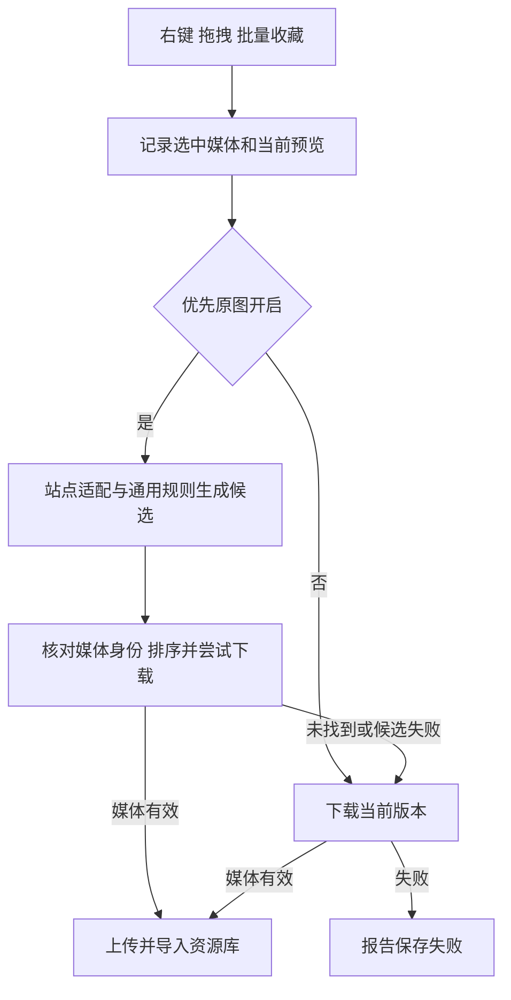

# 网页原图与原视频优先保存方案

日期：2026-11-10。状态：实现基线；当前覆盖和未完成验证见[实现审计](original-media-implementation.md)。

目标是让右键、拖拽和批量收藏共用一条保存链路：优先保存选中媒体可获取的原图或最高质量视频；找不到或下载失败时保存当前预览。用户关闭该行为后，直接保存页面正在使用的版本。截图功能保持截图语义。

这里的“原图”指网站提供的原尺寸文件，或能确认属于同一媒体的最高质量版本；“原视频”指当前账号可获取的完整最高质量版本。网站只公开转码文件时，不承诺恢复上传者的源文件。分辨率放大、解除水印和获取未开放的内容不属于本功能。

## 1. 现状与需要调整的位置

| 位置 | 当前行为 | 设计调整 |
| --- | --- | --- |
| `media-target.ts` | 图片优先选最大 `srcset`，再取 `currentSrc`；视频可从全页请求里按文件名排序兜底 | 分离“页面预览”和“原图候选”；锁定选中元素和媒体身份，禁止用全页最大图片或最高码率视频代替选中项 |
| `page-images.ts` | 批量 `preferHd` 使用图片链接，并无差别删除 `w/h/width/height/resize/fit` | 批量也调用统一解析器；未知域名不删除参数；保留预览 URL 直到保存完成 |
| `content-script.ts`、`radial-menu.ts`、`overlay-menu.ts` | 大多只传递一个 `mediaUrl`，丢失元素上下文 | 传递媒体目标标识、当前版本、所属详情页、内容 ID 和媒体序号 |
| `background.ts` | 原生右键有 `srcUrl` 时不会继续询问内容脚本；保存目标整理时重建 intent | 原生右键也获取对应上下文；统一入口保留新的解析字段；单个保存请求独立管理候选和取消信号 |
| `preferences.ts`、`settings-form.ts` | “优先高清”只属于批量过滤设置 | 升级为全局“穿透保存”设置，优先保存原图和原视频；选项页、工具栏和批量面板共用同一设置 |
| `save-client.ts` | 单 URL 下载后上传；没有候选失败回退；完整响应进 `ArrayBuffer`，上限 500 MiB | 原图候选逐个尝试，最后尝试预览；验证真实媒体；维护有界内存和明确的大小限制 |
| `save-client.ts` 的 HLS 逻辑 | 部分情况下把最高码率播放清单继续当作普通文件下载；含 Pinterest MP4 特例 | 分离完整文件和播放清单；清单必须进入分段下载与合并链路，不能作为视频文件入库 |
| `hotlink-sites.ts` | 已有 Referer 规则 registry，目前只有微博；注释误称 Firefox 不支持动态规则 | 扩展现有 registry，收紧规则作用范围；按实际 API 能力分支处理，不沿用该兼容性假设 |

桌面端已提供 `src/main/extension-server.ts` 的 `/save-upload` 和 `extension.save-from-file` 导入链路。图片和完整视频文件复用现有接口；分段视频需要新增下载会话与合并能力。扩展与桌面端分别位于两个仓库，不能把主仓库中仍引用旧 `extension/` 目录的测试视为独立扩展的现有覆盖。

## 2. 用户行为与设置

- 新用户默认开启，文案为 **穿透保存**，补充说明为“优先保存原图或原视频；没有可用版本时保存当前预览。可关闭，关闭后直接保存当前版本”。
- 关闭后图片保存 `currentSrc`，视频保存当前选中的播放版本；不继续查详情页、不执行升档规则，也不自动选择最高视频轨道。`currentSrc` 是浏览器实际选择的图片 URL，不能用最大 `srcset` 冒充当前预览。[MDN](https://developer.mozilla.org/en-US/docs/Web/API/HTMLImageElement/currentSrc)
- 批量面板继续显示便宜且已加载的预览，不提前下载所有原图。其开关是全局设置的另一个入口，不保留互相冲突的批量专用开关。
- 迁移为独立的 `preferOriginalMedia` 设置。新键缺失时才读取旧 `serpentBatchFilter.preferHd`，保留用户明确关闭的选择；都不存在时使用 `true`。迁移幂等，旧过滤设置的尺寸和格式不变。
- 每次保存开始时冻结这次使用的开关值和目标文件夹/合集。用户随后改设置只影响新任务。
- 原图成功沿用普通保存成功反馈；候选失败但预览成功时显示“已保存当前预览”。批量汇总分别统计原图/最高质量、当前预览和失败数量，沿用现有气泡和通知设置。
- 不把视频封面当成视频兜底。当前视频也无法获取时明确提示失败，不偷偷保存海报或截图。

## 3. 统一处理流程

解析器返回一组带依据的候选，不直接返回一个未经验证的“原图地址”。下载器负责试探、回退和状态；导入成功之前只产生临时产物，最终只导入一个资产。

### 3.1 目标上下文

`MediaSelection` 至少包含：`selectionId`、文档代次、`frameId`、`kind`、`previewUrl`、`pageUrl`、`detailPageUrl`、站点内容 ID、媒体序号、预览尺寸、可用的局部 DOM 证据。元素本体留在内容脚本里，用短时标识关联，不跨进程传 DOM。

右键时记录上下文，即使浏览器提供 `srcUrl` 也要匹配内容脚本记录；记录必须与原生事件的 URL、frame 和文档代次相符，避免上一次右键目标残留。拖拽开始时冻结目标，批量项使用稳定的内容 ID 加媒体序号，解析后不能因为 URL 变化而丢失勾选状态。

对虚拟列表、SPA 换页、多图帖、多个播放器必须按内容身份关联。跨源 frame 由各 frame 的内容脚本处理，后台按事件 `frameId` 定向消息；不可访问的 frame 和封闭 Shadow DOM 保留浏览器暴露的预览地址。开放 Shadow DOM 复用已有 `composedPath` 命中逻辑。

### 3.2 候选与下载计划

`MediaCandidate` 包含候选地址或视频播放计划、媒体类型、对应的内容 ID/序号、来源依据、已声明尺寸或视频轨道信息、请求策略、规则版本。将依据分为：

1. 网站明确给出的原始字段或下载链接，且与所选媒体 ID/序号匹配。
2. 同一媒体的已声明尺寸列表、视频清晰度列表、`srcset` 或已验证的 CDN 原图规则。
3. 有明确同图关联的通用引擎规则或详情页元数据。
4. 当前预览，作为最后一个候选。

“是否同一个媒体”先于画面尺寸。相同媒体内优先明确的 original，其次比较实际尺寸/完整性和清晰度。视频同时考虑分辨率、完整时长、音轨、帧率、编码与可播放性，不能跨编码仅凭码率排序。图片不能用“文件更大”推导“画质更好”，也不能将动画替换为高分辨率静态封面。

结构上分别使用 `DirectFilePlan`、`HlsPlan`、`DashPlan`。`blob:` 只是页面内句柄：普通 Blob 可以请求页面侧读取；MediaSource 的 blob 需要恢复关联播放计划，不能直接当 HTTP 文件处理。[MediaSource](https://developer.mozilla.org/en-US/docs/Web/API/MediaSource)

## 4. 必须显式支持的 18 个网站

下表定义实现覆盖范围，不代表当前已通过兼容性测试。字段与接口的源码依据、稳定性说明见 [站点研究记录](original-media-source-research.md)。列表页、详情页和多图帖分别建 fixture；“一个站点适配器”不等于只写一条 URL 正则。

| 网站 | 图片解析设计 | 视频和特殊内容 |
| --- | --- | --- |
| 百度图片 | 按结果条目 ID/缩略图定位结构化结果，取来源图直链和来源页；处理已识别的代理/编码地址 | 图片搜索页只处理结果明确关联的媒体；来源是视频网页时交给对应视频适配器 |
| 必应图片 | 读取当前结果容器元数据中的媒体直链和来源页，不能保存 Bing 缩略图 CDN 就结束 | 视频搜索卡片的封面仍是图片，不因此抓取整段视频 |
| Google 图片 | 匹配选中结果和其原图/来源页数据，支持结果链接与页面结构化数据两条路径 | 页面数据结构易变化，原图证据缺失时保存缩略图；不扫描整页找最大 URL |
| 搜狗图片 | 从选中结果的原始图地址/结果数据还原候选，保留缩略图回退 | 搜索结果只承诺解析该条目提供的媒体线索 |
| 360 图片 | 从当前结果的原图地址及来源页数据解析，识别代理缩略图 | 同上；不把详情网页 HTML 当图片 |
| Yandex 图片 | 匹配图片结果 ID，使用结果数据中的来源图及尺寸候选 | 只选择当前图片结果，不误取相似推荐 |
| DuckDuckGo 图片 | 使用当前结果的 `image` 直链，区分 `thumbnail` 和来源页面 | 缩略图代理地址解包仅针对已识别格式，不修改任意 query |
| Pinterest | Pin ID 加媒体序号关联 `images` 尺寸信息；对已知 pinimg 规则生成 `originals` 候选并验证 | 优先 Pin 的完整视频地址和清晰度列表；其次 HLS；多图/视频 Pin 只保存选中项 |
| 花瓣 | 用 Pin 的文件对象/标识关联图床原图；仅按已验证图床规则去除缩略变换 | 帖内视频走明确的播放器数据；来源仅给图片时只作为图片处理 |
| Behance | 项目 ID 加模块/图片 ID，读取作品模块的尺寸/原图信息 | 区分原生视频和外链 iframe；嵌入源由对应播放器解析，不猜 Adobe 图片规则适用于视频 |
| 站酷 | 作品 ID 加图片序号，读取作品页 JSON 的 `productImages[].urlBig` 大图候选，再核验是否存在更高质量版本；CDN 变换仅按验证过的规则处理 | 原生视频取对应播放器文件或播放计划；外链播放器分别处理 |
| Dribbble | Shot ID 关联图片资源，取可获取的最高质量静态图或动图 | 视频 Shot 读取对应视频资源，禁止误存 cover；不把未知扩展名统一替换成 JPG |
| ArtStation | 作品 hash 加 asset ID，使用项目资产 URL 与已验证的原图候选 | 原生视频和嵌入播放器分别识别；Marmoset/交互 3D 不伪装为视频 |
| 小红书 | Note ID 加图片序号关联页面数据中的图片信息/清晰度候选 | 根据当前笔记的视频播放信息选择完整版本；保留签名；不自行臆造签名算法 |
| Instagram | Post/Reel ID 加 carousel 子项 ID，选择图片尺寸候选 | 同一子项的视频版本/播放计划；登录态与短期 CDN 地址在用户浏览器内使用 |
| 微博 | Status ID 加 pic ID，取 `large/original` 等已声明媒体版本 | 读取当前 status 对应的视频质量信息；复用并扩展现有新浪图床 Referer registry |
| Pixiv | Illust ID 加页码，使用该页 `urls.original` 或页面列表中的原始地址 | 插画单页与漫画逐页对应；Ugoira 是帧包加时序的动画格式，另设转换任务，不能把封面当原动画 |
| X | Status ID 加 media key，取当前媒体的图片 original 尺寸候选 | 使用该 media key 的视频 variants/播放计划；保留音轨，动画型 MP4 保持其实际媒体性质 |

搜索引擎返回的原图可能是任意第三方图床，找到直链不等于直链一定可访问。可再取一次该条目的来源详情页、运行对应站点适配器或通用规则；默认最多一次详情页跟进，不递归追站、不搜索整站、不自动操作“展开/下载”按钮。

## 5. 通用兜底

按以下顺序组合，所有路径都必须关联到当前目标：

1. **同一元素与局部容器**：`data-original` 等已知属性、`srcset`、`picture/source`、指向媒体文件的包裹链接。相对链接按所在文档的 base URL 解析。不同 `picture` 分支可能是不同裁切，不能只比较数字。生产实现采用标准兼容的 `srcset` 解析，避免沿用简单逗号切分。
2. **已知站点/CDN/通用建站引擎规则**：WordPress、MediaWiki 和常见图床的尺寸路径等。只在识别了引擎和稳定媒体身份后生成升级候选；不能对所有域名统一删 `width` 或删任意 URL 后缀。
3. **所选内容的结构化数据**：JSON-LD 的 `ImageObject/VideoObject`、页面内 JSON 和详情页明确的媒体信息。`og:image` 经常是分享封面，只有已证明对应所选图片时才可用，不能作为任意图片的全页兜底。
4. **有限详情页跟进**：只跟当前图片所属内容链接，提取数据而不执行远端 HTML/JavaScript；候选必须与已有媒体 ID、URL 标识或图片指纹相符，无法确定时回到预览。
5. **与当前媒体关联的请求信息**：优先复用页面已有的数据。`performance` 只能提供有限请求线索，不能提供所有响应正文，更不能靠全页请求排序确认归属。

Image Max URL 已提供大量站点和通用引擎规则，可作为兜底规则的主要来源。[项目说明](https://github.com/qsniyg/maxurl)

建议固定上游版本，在后台规则模块中复用经过 fixture 验证的纯候选生成规则，保留来源和 Apache-2.0 声明；它的仓库 package 标记为 private，不按普通 npm 依赖直接安装。先选择需要的规则/模块并测包体和同步执行耗时，再决定是否扩大规则集合。完整用户脚本包含额外交互和请求行为，不应直接注入每个网页。规则随扩展发版，不远程下发可执行 JavaScript。

Hover Zoom+ 的浏览器站点插件适合参考 DOM/详情页关联；gallery-dl 适合参考图片站的身份、分页和原始字段；yt-dlp 适合参考视频清晰度、流清单和合并行为。优先复用自身代码，不能把这些项目中的 Python 提取器直接当浏览器插件运行。使用代码时逐文件核对授权；gallery-dl 的 GPL 代码不直接拷入当前 MIT 工程。[Hover Zoom+](https://github.com/extesy/hoverzoom)、[gallery-dl](https://github.com/mikf/gallery-dl)、[yt-dlp](https://github.com/yt-dlp/yt-dlp)

## 6. 站点数据与浏览器边界

内容脚本负责命中元素、收集最小必要证据和展示反馈；扩展后台负责站点规则选择、网络请求、重试、回退和上传。跨域下载留在具有 host permission 的扩展上下文，不能因为有权限就认为内容脚本跨域 fetch 也不受 CORS 限制。[Chrome 网络说明](https://developer.chrome.com/docs/extensions/develop/concepts/network-requests)

Chromium 后台是无 DOM 的 service worker，详情页解析使用随包提供的纯 HTML/JSON 解析模块，不能直接调用 `DOMParser` 或 `new Image`。图片验证封装成浏览器能力适配层；如确需 offscreen document 的 DOM 能力，应单独声明权限与用途，不把它当无限续命工具。[后台与 offscreen 能力](https://developer.chrome.com/docs/extensions/reference/api/offscreen)

优先读取 DOM 中的 JSON/script 数据。仅在站点必须读取页面内存状态时，启用该域名的独立 page bridge：只读取明确的内容 ID 对应字段；不 `eval` 页面脚本，不遍历所有全局对象，不接收网页发起的任意下载命令。桥返回的数据仍是不可信输入，需要类型、大小、域名与媒体身份校验。

若媒体数据只能在页面请求响应里得到，为该站点注册文档启动时的轻量 bridge，限定目标接口和 JSON 字段，使用有界内存索引；不全站 hook 所有请求，不收集 Cookie、Authorization 或完整响应正文。已加载的数据没被捕获时优先读页面状态或按现有登录态发起内容详情请求，失败正常回退。

当前 Firefox manifest 最低版本是 115，但 `MAIN` execution world 从 Firefox 128 才有相应支持。建议将需要 page bridge 的完整能力目标定为 Firefox 128+；如继续声明 115，必须明确旧版本仅运行 DOM/JSON/规则链路并回退，不能宣称两者覆盖相同。Chromium 沿用项目现有构建目标。DNR 动态规则 Firefox 已有支持，原有“不支持”的代码注释应更正。[MAIN 兼容数据](https://github.com/mdn/browser-compat-data/blob/main/webextensions/api/scripting.json)、[动态规则兼容数据](https://github.com/mdn/browser-compat-data/blob/main/webextensions/api/declarativeNetRequest.json)

扩展 manifest 只因实际能力增加所需权限，例如可选 page bridge 的 `scripting`。跨 frame 注入按权限与文档可访问性处理。Referer 沿用现有 DNR registry，并限制到相关 CDN 与扩展自身发起的请求，不改写用户正常浏览请求；动态 header 规则按任务生命周期清理。带 `credentials: include` 也不保证绕过 SameSite、Cookie 分区和站点校验，必须按浏览器实测处理。

## 7. 下载验证与失败回退

### 7.1 下载状态与限额

建议初始预算：每项最多三个升档候选加预览；同一条目最多一次详情页跟进；元数据请求单次 3 秒、整个解析阶段约 6 秒；文件请求等待响应头约 10 秒。数值是实现初值，后续依据真实样本调整。解析超时与文件传输超时分开，不能把大视频的完整传输限定为 10 秒。

原图候选的 404、403、过期、错误类型、解码失败、超限均进入下一个候选；401/403 可重新读取同一内容一次刷新短期地址，429 应遵守退避，不能轮流轰炸端点。预览最后尝试一次。用户取消、桌面端断连、目标失效或磁盘不足属于任务/导入失败，不是改存预览的理由；上传失败后不得换候选重复导入。

批量保持现有最多 200 项和顺序入库，解析/预取按站点限流并发，初始全局不超过 3、同站不超过 2。完成进度按资产计数，回退不额外增加总数；原图失败不算整批失败，预览成功计为成功。总失败计数必须覆盖失败和未执行项，不能沿用遇到第一项错误就用不完整数量宣称全部结束。

### 7.2 不能仅判断 HTTP 200

- 核对实际响应 MIME、文件头和结构，拒绝验证码、登录页、HTML/JSON 错误页、XML、HLS/DASH 清单伪装成媒体文件。
- 图片使用实际尺寸和可解码性验证。高可信站点原图字段允许与裁切预览比例不同；只有猜测变换时，尺寸变大仍不足以证明同图，可比较缩小后的指纹。无法确认同图时放弃该猜测候选。
- SVG 等格式使用专门的安全识别路径，不能因不支持位图解码就误判损坏，也不能把网络正文作为 HTML 插进扩展 UI。
- 视频必须是完整媒体结构；需要检查时长、画面轨道、尺寸和预期音轨。完整性不能只凭文件扩展名或 Content-Type。
- 保留 HTTP 最终 URL 与所用候选，上传元数据反映实际保存的媒体；不继续把最初的缩略图 URL 记成已成功的原图。短期签名和令牌仅用于本次保存任务（包含中断恢复），日志和长期来源记录使用不含凭据的内容身份或稳定 URL。
- 保持现有 500 MiB 单文件上限，未知长度的响应在读取过程中实时计数和中止。不能等 `arrayBuffer()` 完整占用内存后才发现超限。

## 8. 视频完整文件与分段流

### 8.1 完整文件

站点提供 progressive MP4/WebM 时，选择当前目标的最高可用完整版本，仍由浏览器下载、上传 `/save-upload`。禁止以 HEAD 成功作为唯一证明；HEAD 被禁用时允许受限 GET。流类型按响应内容判断，不能只判断 URL 是否以 `.m3u8` 结束。

开关关闭时走当前播放版本。现有 Pinterest 地址变换可保留为 Pinterest 适配器的已验证候选，不能留在通用网络层中对任意 HLS 自动猜 MP4。

### 8.2 HLS 与 DASH

分段流也是完整需求的一部分，需要扩展与桌面端协同实现，不在扩展中塞 FFmpeg WASM。建议使用成熟的 [m3u8-parser](https://github.com/videojs/m3u8-parser) 和 [mpd-parser](https://github.com/videojs/mpd-parser) 解析清单，复用桌面已随包提供的 FFmpeg 进行无重编码封装。

1. 浏览器按当前登录态取得清单，绑定所选视频 ID，选择一套视频轨道与匹配音轨。开关关闭时使用当前 representation，身份或清晰度无法确认时不擅自升档。
2. 桌面端声明 `segmentedMediaUpload` 能力；扩展建立下载会话，冻结资源库与文件夹/合集目的地。旧桌面端不支持时尝试完整文件预览；没有则提示需要更新，不上传清单。
3. 扩展下载初始化段、媒体段和所需 byte-range，分块上传本机；Cookie/登录令牌不导出到桌面端。每次只保留少量数据，例如 4 MiB 缓冲；分段 ID 和长度由任务清单限定。
4. 桌面端对会话实行短期令牌、限额、分段校验和幂等，数据写入目标库所在磁盘的受管临时目录，预检片段与合并产物同时存在时所需空间；Main 只处理传输，Worker 管理合并、媒体验证及最终导入。现有 500 MiB 限制按整个逻辑资产累计执行，不能通过分段接口绕过。
5. Worker 生成只引用受管本地片段的清单，FFmpeg 限制协议与文件范围、无重编码合并，再检查时长/尺寸/音轨。不得执行来自网页的任意 FFmpeg 参数或让清单额外读取远端/本地任意文件。
6. 会话完成一次性提交为资产；成功、失败、取消均清理片段；异常退出后按受管任务记录回收。切库不得改变已冻结的目的地，目标关闭则等待或明确失败。

覆盖无加密点播 HLS 的 master/media playlist、独立音轨、初始化段、byte-range、discontinuity，以及静态 DASH 的常用分段与独立音视频。直播、DRM、特殊加密和无法完整还原的页面播放记录列为不支持的类型；可获取完整预览时仍回退。Pixiv Ugoira 单独规划帧时序合成，不能用 HLS 逻辑假装覆盖。

MV3 后台可能被回收，不能把大视频唯一状态放在全局变量。保存受管会话 ID、分段进度和可重建的身份数据，通过启动事件与已有 alarms 调度未完成任务；每次传输按有限片段/范围执行，恢复时重新解析过期链接并从可验证片段继续。会话提交有幂等键，响应丢失时先查提交状态，不能重复导入资产。该会话方案也解决超过现有单个长调用生命周期的问题。Chrome 的后台有空闲、请求和 fetch 等生命周期限制，设计以可中断恢复为前提。[生命周期说明](https://developer.chrome.com/docs/extensions/develop/concepts/service-workers/lifecycle)

实施调整：为使上述恢复能够跨后台回收与浏览器重启，任务 journal 可在 `storage.local` 中短期保存本次任务的签名媒体地址和桌面会话令牌，最长不超过任务恢复期限；有数量、体积和 TTL 上限，终态或过期后清除，不进入 `storage.sync`、日志、fixture 或长期资产来源。此规则替代初稿中“仅用于当次请求”的表述，不包含保存网站 Cookie、Authorization 或账号凭据。

## 9. 模块划分

扩展建议新增以下模块，名字是职责建议，实施时按现有布局调整：

| 模块 | 职责 |
| --- | --- |
| `media-selection.ts` | 目标记录、文档代次、frame 和媒体序号；复用现有命中代码 |
| `media-resolution/types.ts` | 目标、候选、下载计划、结果的公共类型和运行时校验 |
| `media-resolution/registry.ts` | 按站点分派适配器，声明详情页/CDN 范围与版本 |
| `media-resolution/sites/` | 18 个站点的局部提取和关联规则；允许共享搜索/图床机制 |
| `media-resolution/generic.ts` | DOM/JSON-LD/已知引擎与受限详情页兜底 |
| `media-resolution/rules/` | 固定版本的原图 URL 规则及来源、授权说明 |
| `media-resolution/download.ts` | 候选排序、限时、验证、原图到预览的回退 |
| `page-bridge.ts` | 仅特定站点需要的最小页面状态读取，不拥有保存权限 |
| `media-transfer.ts` | 直接文件传输和分段会话，承接浏览器后台恢复 |

保留 `save-client.ts` 的本机连接与上传接口职责；所有入口都把统一目标交给解析/下载服务。`background.ts` 只做消息协调，不继续内联 18 个站点分支。`settings-form.ts` 继续作为 popup 和 options 的统一绑定位置。

完整文件阶段可以基本限制在扩展仓库；视频会话阶段需要同步更新桌面 HTTP 接口、typed Worker 协议、任务生命周期与导入路径。新字段应通过能力协商兼容旧扩展/旧桌面端，不因一方升级就破坏原有保存。

## 10. 分阶段实施与完成条件

| 阶段 | 交付 | 完成条件 |
| --- | --- | --- |
| 0 站点取样 | 开发前固定当前页面样本和上游规则版本，先核实搜狗、360、站酷与小红书等证据薄弱路径 | 区分“确有原图字段”“只能得到更大图”“只有预览”；未确认的字段不进入兼容承诺 |
| A 统一保存语义 | 预览/候选分离、全局设置及迁移、所有入口统一、候选验证与失败回退 | 开关关闭实际保存当前版本；损坏原图能退到预览；多图/多视频不串项；原始来源记录正确 |
| B 显式网站支持 | 18 个站点的图片规则及各站可用的完整视频文件路径，有限详情页跟进 | 每站有独立 fixture 和当前页面验证记录；搜索列表、详情、多媒体序号有明确覆盖；不能只凭通用规则算显式支持 |
| C 视频点播闭环 | HLS/DASH、音视频合并、下载会话、取消/中断恢复与清理 | 实际入库为可解码完整视频、时长正确且音轨符合预期；旧桌面端安全降级；清单绝不伪装成视频 |
| D 长尾与维护 | Image Max URL 规则子集、通用引擎、解析失效率与样本维护 | 未知网站保守回退；包体/执行时间可接受；规则版本和失效证据可定位 |

A/B 可以先交付测试，但只能声称图片和已覆盖的完整视频文件可用；整体需求收口需 C 完成。D 先带保守通用链路，再按样本扩充，不以“支持任意网站”为完成承诺。

## 11. 验收计划

本轮只产出方案，不新增或运行测试。实施时在独立扩展仓库建立真实测试入口，迁移仍滞留在桌面仓库且引用旧目录的相关用例，避免两套源码漂移。

| 验收项 | 自动化证据 | 真实浏览器证据 |
| --- | --- | --- |
| 18 站原图选择 | 每站正例、当前 DOM 变体、无原图、失效链接、错误媒体等脱敏 fixture | 每站选定图片，比较实际入库尺寸/内容与原图信息；记录浏览器、入口、登录状态与适配器版本 |
| 所有入口一致 | 右键即使自带 srcUrl 也解析上下文；拖拽、Alt 右键、批量相同目标产出一致 | 三种主要入口各跑开/关与回退；截图保持原语义 |
| 严格预览模式 | 当前 `srcset` 中小图、picture 裁切、视频低清晰度不会自动升档；确认不请求详情/升档端点 | 入库尺寸/轨道等于当前版本 |
| 准确关联 | 同页两视频、多图轮播、头像与正文共存、iframe、SPA/虚拟列表、旧右键记录 | 保存指定项，确保没有混入其他图片或视频 |
| 下载有效性 | 200 HTML、验证码、错误 MIME、坏图、假高分辨率占位图、HEAD 405、签名过期、超限/未知长度、429 | 失败反馈与预览回退符合文案，资源库不出现错误文件 |
| HLS/DASH | 初始化段、独立音轨、range、片段失败/重试、音画时长、关闭开关不升档 | 实际解码视频并验证音频，不只断言“任务完成” |
| 状态与兼容 | MV3 回收、浏览器重启、断网、旧桌面、重复提交、任务目标关闭/切换 | Chrome/Edge/Firefox，Windows/macOS 与桌面导入联通；不把未跑的平台写成通过 |
| 临时产物 | 成功/失败/取消/崩溃后会话目录对账，限制磁盘和内存占用 | 用户库最终只有一个完整资产，无清单和分片残留 |

统计命中率时分开记录“找到候选”“验证成功”“回退预览”“最终保存成功”“保存错媒体”。不能拿最终保存成功率当原图命中率。优先确保错媒体为零，再提高命中率。网站实测使用公开或授权样本，fixture 脱敏，不记录真实 Cookie、签名和个人页面数据。

## 12. 实施前需要明确的边界

- 所列 18 站全部纳入显式适配，不以搜索引擎能展示该站缩略图代替支持。
- “退回预览”要求预览本身可下载；MediaSource、DRM 或不可访问的源文件可能使两条路径都失败，这时诚实报告失败。
- 搜索引擎只保留低清源图、源站删除文件或当前账号没有高清版本时，规则和 AI 都无法恢复不存在/不可获取的真实原始文件；不做生成式放大来冒充原图。
- 版本易变的网站字段是实现线索，最终兼容性以真实页面和媒体字节验证为准。站点适配失效不能拖垮普通预览保存。

